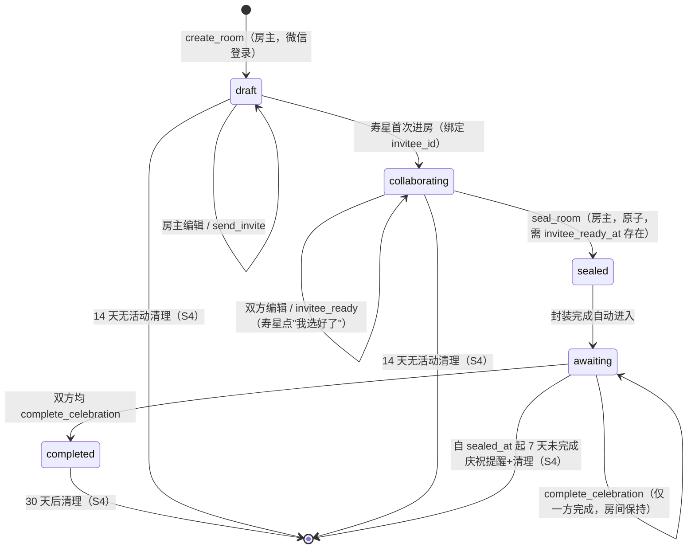

# v1 状态机规格（DearU · 亲爱的你）

> 配套文档：`v1产品契约决策回答.md`（稳定版 v1.1）。本文件将契约中的 5 态状态机落成开发可直接实现的事件-状态-权限定义。

## 1. 状态定义

| 状态 | 代码 | 含义 | 可编辑蛋糕 | 可庆祝 |
|------|------|------|-----------|--------|
| 草稿 | `draft` | 房主建房、打底、配置流程 | 房主 | 否 |
| 协作中 | `collaborating` | 寿星进房，选口味+装饰+写祝福 | 双方 | 否 |
| 已封装 | `sealed` | 房主原子封装，内容锁定 | 否 | 待开始 |
| 待庆祝 | `awaiting` | 双方各自点"开始庆祝"，本地播放 | 否 | 是（手动）|
| 已完成 | `completed` | 仪式走完，限时重看 | 否 | 否 |

## 2. 状态流转图（Mermaid）

## 3. 事件 → 状态 → 权限 表

| # | 事件 | 触发方 | 前置态 | 目标态 | 约束 / 副作用 |
|---|------|--------|--------|--------|--------------|
| E1 | `create_room` | 房主 | — | `draft` | 须微信登录；生成 `room_id`、`invite_link_token` |
| E2 | `edit_cake_creator` | 房主 | `draft`/`collaborating` | 同态 | 仅制作阶段；写 `cake_state` |
| E3 | `send_invite` | 房主 | `draft`/`collaborating` | 同态 | 不发第二次链接；同一个 `invite_link_token` |
| E4 | `enter_room_invitee` | 寿星（首位非房主）| `draft`→`collaborating` | `collaborating` | 首位**非房主**打开者绑 `invitee_id`；**房主本人打开（预览/重进/测试）永不绑定为 invitee**；若 `invitee_id` 已绑则进入既有态 |
| E5 | `edit_cake_invitee` | 寿星 | `collaborating` | 同态 | 仅 `collaborating`；写 `cake_state` |
| E6 | `invitee_ready` | 寿星 | `collaborating` | 同态 | 记 `invitee_ready_at`；房主端显"可以封装礼盒" |
| E7 | `seal_room` | 房主 | `collaborating` | `sealed` | **原子操作**；前置条件：`invitee_ready_at` 非空，否则拒绝；锁定 `cake_state` |
| E8 | `start_celebration` | 房主/寿星 | `awaiting` | 同态 | 各自本地播放；按角色记 `creator_started_at` / `invitee_started_at`；不强制双方同步 |
| E9 | `complete_celebration` | 本地/系统 | `awaiting` | `awaiting`（仅一方）/ `completed`（双方均完成）| 按角色记 `creator_completed_at` / `invitee_completed_at`；仅当两者均非空时房间置 `completed` 并开启 30 天重看窗口 |
| E10 | `revoke_link` | 房主 | 非 `completed` | 同态 | 链接失效；第三人此后打开即拒 |
| E11 | `delete_room` | 房主 | 任意 | 删除 | 逻辑删除；清理私人内容 |
| E12 | `auto_cleanup` | 系统 | `draft`/`collaborating` | 删除 | 按 S4 生命周期（14 天无活动）；`awaiting`/`completed` 的清理见状态流转图与 §5.4 |

## 4. 权限矩阵

| 操作 | 房主 | 寿星 | 第三人（已转发链接）|
|------|------|------|---------------------|
| 建房 / 编辑蛋糕（制作阶段）| ✅ `draft`+`collaborating` | ✅ 仅 `collaborating` | ❌ 拒绝访问（不返回任何内容）|
| 点"我选好了" | ❌ | ✅ `collaborating` | ❌ |
| 封装（seal）| ✅ 需寿星 ready | ❌ | ❌ |
| 开始庆祝 | ✅ `awaiting` | ✅ `awaiting` | ❌ |
| 撤销链接 / 删房 | ✅ | ❌ | ❌ |

## 5. 边界规则（实现必读）

1. **第三人（非 creator/invitee）打开链接**：直接拒绝访问，仅显示"这不是给你的"，**不返回任何房间内容**（含蛋糕/祝福语/愿望）。v1 不做"只读"分支，避免内容泄露（私密 1:1 的核心）。
2. **封装原子性**：E7 必须在一个事务内完成 `invitee_ready_at` 校验 + 状态置 `sealed` + `cake_state` 锁定，失败回滚。
3. **未 ready 不可强制封装**：寿星未点"我选好了"前，E7 直接拒绝，房间保持 `collaborating`。
4. **清理周期（S4）**：`draft`/`collaborating` 连续 14 天无 `last_activity_at` 更新 → 清理；`awaiting` 自 `sealed_at` 起 7 天未完成庆祝（双方均未 complete）→ 提醒后清理；`completed` 自 `max(creator_completed_at, invitee_completed_at)` 起 30 天 → 清理。
5. **链接路由**：同一个 `invite_link_token` 按当前 `status` 自动渲染制作页 / 等待庆祝页 / 重看页，不随状态生成新链接。
