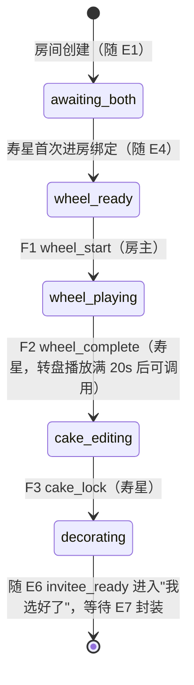

# v1.1 转盘仪式与协作合并规格（DearU · 亲爱的你）

> 配套文档：`v1-状态机.md`（v1 基线状态机，5 态不变）、`v1-数据模型.md`、`v1产品契约决策回答.md`。
> 本文件是 v1 的增量规格，不改动 `room.status` 的 5 态定义，只在 `collaborating` 状态内部新增一层子阶段（`making_phase`），并重写 `PUT /cake` 的保存语义。全文为开发可直接实现的事件-状态-权限-算法定义。

## 0. 变更摘要

| 原 v1 行为 | v1.1 新行为 | 原因 |
|---|---|---|
| 寿星进房即可直接编辑蛋糕全部字段 | 寿星进房先经历转盘仪式授予底胚权/口味权，房主经历转盘授予"惊喜使命" | 产品侧要求仪式感前置，权力分配要被感知到 |
| 底胚/口味双方均可随时改 | 转盘后仅寿星可改，寿星确认锁定后双方均不可再改 | 产品要求"决定权"是真实限制，不是装饰性文案 |
| `collaborating` 阶段无轮询，双方改动靠手动刷新可见 | 装饰阶段（含转盘等待）8 秒轮询，实时感知对方新增的贴纸/涂鸦 | "一起做蛋糕"的在场感是核心留存钩子，不能砍 |
| `PUT /cake` 整体覆盖写入（后到请求覆盖先到请求，包括已存在图层） | `PUT /cake` 改为服务端按图层 id 合并（upsert），不再发生静默覆盖丢数据 | 全量覆盖在双人并发场景下是真实 bug（会话记录已证实），不是边缘风险 |
| 删除图层靠下次全量 PUT 时数组里少一项 | 删除图层走独立 `DELETE` 接口，`PUT` 永不处理删除语义 | 避免"删除"和"过期全量快照"的语义冲突 |

## 1. 子状态定义（`making_phase`，仅在 `room.status === 'collaborating'` 时有效）

| 子阶段 | 代码 | 含义 | 可编辑范围 |
|---|---|---|---|
| 等待双方到场 | `awaiting_both` | 房主已建房，寿星尚未进房 | 房主可编辑贴纸/涂鸦（延续 v1 draft 行为），底胚口味不限 |
| 待开启转盘 | `wheel_ready` | 寿星已绑定进房，房主可点"开启转盘" | 同上 |
| 转盘播放中 | `wheel_playing` | 房主已开启，双方应播放三连转盘动画 | 同上（转盘是前端展示层，不锁编辑） |
| 寿星定底胚口味 | `cake_editing` | 转盘播完，寿星选底胚/口味，双方可画涂鸦贴贴纸 | 底胚/口味仅寿星可改；贴纸/涂鸦/文字双方可改 |
| 自由装饰 | `decorating` | 寿星已确认锁定底胚口味 | 底胚/口味任何人不可改（只读）；贴纸/涂鸦/文字双方可改 |

子阶段初始值：房间创建时（E1）即写入 `making_phase = 'awaiting_both'`，与 `status = 'draft'` 同时存在（`making_phase` 字段在 `draft`/`sealed`/`awaiting`/`completed` 态下不产生行为影响，仅在 `collaborating` 态被读取）。

## 2. 子状态流转图（Mermaid）



## 3. 事件 → 状态 → 权限表（增补，编号接续 `v1-状态机.md` 的 E 系列，新事件用 F 前缀区分）

| # | 事件 | 触发方 | 前置子阶段 | 目标子阶段 | 约束 / 副作用 |
|---|---|---|---|---|---|
| F1 | `wheel_start` | 房主 | `wheel_ready` | `wheel_playing` | `UPDATE ... WHERE making_phase = 'wheel_ready'`，按影响行数判断成功；记 `wheel_started_at`；非房主调用 403 `FORBIDDEN`；非房间成员 403 `ACCESS_DENIED` |
| F2 | `wheel_complete` | 寿星 | `wheel_playing` | `cake_editing` | 前置：`wheel_started_at` 距当前时间 ≥ 20s（防跳过转盘动画直接调用）；`UPDATE ... WHERE making_phase = 'wheel_playing'`；非寿星调用 403 |
| F3 | `cake_lock` | 寿星 | `cake_editing` | `decorating` | `UPDATE ... WHERE making_phase = 'cake_editing'`；记 `cake_locked_at`；锁定后 `style`/`flavor` 对任何人只读；非寿星调用 403 |
| F4 | `cake_layer_delete` | 房主/寿星 | `cake_editing`/`decorating`（以及 `draft`/`wheel_*`，延续原有编辑权限） | 同态 | 按图层 id 从数据库数组中摘除；`cake_version += 1`；越权删除（如寿星删底胚层，底胚非独立图层故不适用）按现有编辑权限校验 |

`E4`（寿星首次进房绑定）的副作用在 v1.1 中追加一条：若绑定成功且当前 `making_phase === 'awaiting_both'`，同一事务内将其推进为 `wheel_ready`。寿星重进（已绑定后再次打开链接）不重复触发此推进，沿用 `E4` 原有的"既有态直接返回"逻辑。

## 4. `PUT /rooms/:id/cake` 保存语义重写

### 4.1 字段级权限（第一层校验，先于合并）

```
请求体包含 style 或 flavor 的值与数据库当前值不同：
  若 making_phase === 'cake_editing' 且请求者不是寿星 → 403 FORBIDDEN
  若 making_phase === 'decorating' 或之后 → 该字段变化被静默忽略，不报错，以数据库旧值为准
其余子阶段（awaiting_both / wheel_ready / wheel_playing）：style/flavor 不限（延续 v1 draft 阶段仅房主编辑的既有权限，不受本次改动影响）
```

### 4.2 图层合并算法（第二层，upsert-only，无删除语义）

```javascript
function mergeCakeLayers(dbLayers, clientLayers) {
  const clientIds = new Set(clientLayers.map(l => l.id));
  const merged = [...clientLayers]; // 客户端提交的图层，全部采纳（新增或覆盖同 id）
  for (const dbLayer of dbLayers) {
    if (!clientIds.has(dbLayer.id)) {
      merged.push(dbLayer); // 数据库有、客户端没有 → 对方新增的，保留
    }
  }
  merged.sort((a, b) => a.zIndex - b.zIndex);
  merged.forEach((layer, index) => { layer.zIndex = index; }); // 服务端统一重排，客户端不得再本地重算
  return merged;
}
```

`cake_version` 每次成功写入 `+1`，随响应体一并返回，供前端判断是否需要重新拉取合并。

### 4.3 已知取舍（不是实现缺陷，不需要加日志/告警）

- **删除竞态窗口**：房主通过 `DELETE` 接口删除图层后，若寿星此时携带"删除前的全量快照"发起一次 `PUT`（即寿星本地尚未感知删除），该图层会被 4.2 算法当作"对方新增"重新加回。窗口受限于 800ms 保存 debounce + 8s 轮询，最坏情况下已删除的图层短暂闪回一次，用户再删一次即可消除。v1.1 接受此取舍，不引入删除日志表。
- **同图层并发覆盖**：双方几乎同时拖拽同一图层并先后保存，后到请求的版本胜出（layer 级 last-write-wins）。发生概率低（需双方同时操作同一个贴纸），且不造成数据丢失（只是位置以后到者为准），v1.1 接受。

## 5. 前端显示侧合并（轮询拉取后的本地渲染层，与 4.2 服务端算法独立）

服务端合并解决"保存不丢数据"，显示侧合并解决"轮询刷新不打断正在操作的手指"，两者职责不重叠：

```javascript
function mergeForDisplay(localCake, remoteCake, draggingLayerId) {
  const localLayers = new Map(localCake.layers.map(l => [l.id, l]));
  const merged = remoteCake.layers.map(remoteLayer =>
    remoteLayer.id === draggingLayerId && localLayers.has(remoteLayer.id)
      ? localLayers.get(remoteLayer.id)  // 本地手指正按着的图层，暂不采纳远端版本
      : remoteLayer                       // 其余信任服务端（含服务端已重排的 zIndex，不本地重算）
  );
  const remoteIds = new Set(remoteCake.layers.map(l => l.id));
  for (const localLayer of localCake.layers) {
    if (!remoteIds.has(localLayer.id)) merged.push(localLayer); // 本地刚画、尚未保存成功的
  }
  return { style: remoteCake.style, flavor: remoteCake.flavor, layers: merged };
}
```

`draggingLayerId` 仅存在于前端内存态，**不提交给服务端持久化**，也不出现在 4.2 服务端合并算法的任何分支中——服务端合并对所有图层一视同仁地采纳客户端提交版本，跨用户的"正在拖拽保护"在服务端层面不成立，只在本端显示层生效。

## 6. 轮询策略

| 子阶段 | 是否轮询 | 间隔 | 停止条件 |
|---|---|---|---|
| `awaiting_both` / `wheel_ready` / `wheel_playing` | 是 | 8s | 进入 `cake_editing` 后继续（不在此处停，见下） |
| `cake_editing` / `decorating` | 是 | 8s | 寿星触发 `invitee_ready`（E6，"我选好了"）后停止 |
| `sealed` / `awaiting` / `completed` | 否 | — | 延续 v1 原有的手动刷新模式 |

轮询拉取到的响应若 `cakeVersion` 与本地一致，跳过第 5 节的显示侧合并（无变化，避免无意义重渲染）。

## 7. 权限矩阵（增补，叠加 `v1-状态机.md` 第 4 节，不覆盖原表）

| 操作 | 房主 | 寿星 | 第三人 |
|---|---|---|---|
| 开启转盘（F1）| ✅ 仅 `wheel_ready` | ❌ | ❌ |
| 确认转盘播完（F2）| ❌ | ✅ 仅 `wheel_playing` 且满 20s | ❌ |
| 改底胚/口味 | ❌（`cake_editing`/`decorating` 均不可）| ✅ 仅 `cake_editing` | ❌ |
| 锁定底胚口味（F3）| ❌ | ✅ 仅 `cake_editing` | ❌ |
| 改贴纸/涂鸦/文字 | ✅ 全程（`cake_editing`+`decorating`）| ✅ 全程 | ❌ |
| 删除图层（F4）| ✅ | ✅ | ❌ |

## 8. 数据模型增补

`room` 表新增字段（SQLite `ALTER TABLE ADD COLUMN`，需配套"检测列是否存在再执行"的迁移保护，避免重复执行报错）：

| 字段 | 类型 | 默认值 | 说明 |
|---|---|---|---|
| `making_phase` | TEXT | `'awaiting_both'` | 本文件第 1 节五态之一 |
| `wheel_started_at` | TEXT | NULL | F1 写入 |
| `cake_locked_at` | TEXT | NULL | F3 写入 |
| `cake_version` | INTEGER | `1` | 每次 `PUT /cake` 或 F4 成功后 `+1` |

`formatRoomResponse` 需同步新增 `makingPhase`、`cakeVersion` 两个 camelCase 字段，覆盖 `rooms.js`、`invites.js` 所有返回分支。

## 9. 转盘文案落点（固定值，非真随机）

| 转盘 | 授予对象 | 落点含义 |
|---|---|---|
| 转盘①（底胚权）| 寿星 | 今天的蛋糕底胚由寿星决定 |
| 转盘②（口味权）| 寿星 | 口味同样由寿星决定 |
| 转盘③（惊喜使命）| 房主 | 房主负责用这块蛋糕给寿星制造惊喜 |

三个转盘双方均完整看到全部三段内容，互不保密。文案变体库见产品侧既有素材，v1.1 首版固定使用变体库第一条，随机抽取排入 P1。

## 10. 边界规则（实现必读，延续 `v1-状态机.md` 第 5 节的写法）

1. **转盘重播规则**：`making_phase === 'wheel_playing'` 期间，任意一方重新进房/刷新页面，前端均从转盘①重新播放完整三连动画，不做"已播放过"的本地记忆。转盘内容对双方公开，重播无代价。
2. **F2 的 20 秒前置条件**：仅用于防止跳过动画直接调用接口，不是强依赖前端计时精确对齐；前端动画时长与 20 秒校验允许存在小幅误差（前端可设计为约 18-20 秒播完，接口侧 20 秒是下限保护，不是精确同步点）。
3. **第三人访问新接口**：F1/F2/F3/F4 均先判定请求者是否为房间成员（`creator_id`/`invitee_id`），非成员统一返回 `403 ACCESS_DENIED`（"这不是给你的"），是成员但角色不符再返回 `403 FORBIDDEN`，与 `v1-状态机.md` 边界规则 1 的分层方式一致，避免通过错误码差异推断房间状态。
4. **`decorating` 阶段轮询不停**：装饰阶段（含转盘等待）全程保持 8 秒轮询直到寿星点击"我选好了"，这是本次改版的核心产品诉求（在场感），不可因为"已锁定底胚口味"而提前停止。
5. **`PUT /cake` 不处理删除**：客户端全量提交的 `cakeState.layers` 中，服务端永远不会因为"客户端数组里少了某一项"而删除数据库中的对应图层（见第 4.2 节算法）。删除必须显式调用 F4 独立接口。

## 11. 未决事项（留给排期，不阻塞本规格冻结）

- 文字祝福输入入口（P1，与转盘无关的独立缺口，详见产品侧既有待办）
- 转盘文案随机抽取（P1）
- `decorating` 阶段结束后（E6 之后）是否需要继续轮询，当前规格判定为否（延续 v1 `sealed`/`awaiting` 手动刷新模式），如产品侧后续认为"等封装"阶段也需要在场感，需另行评审
